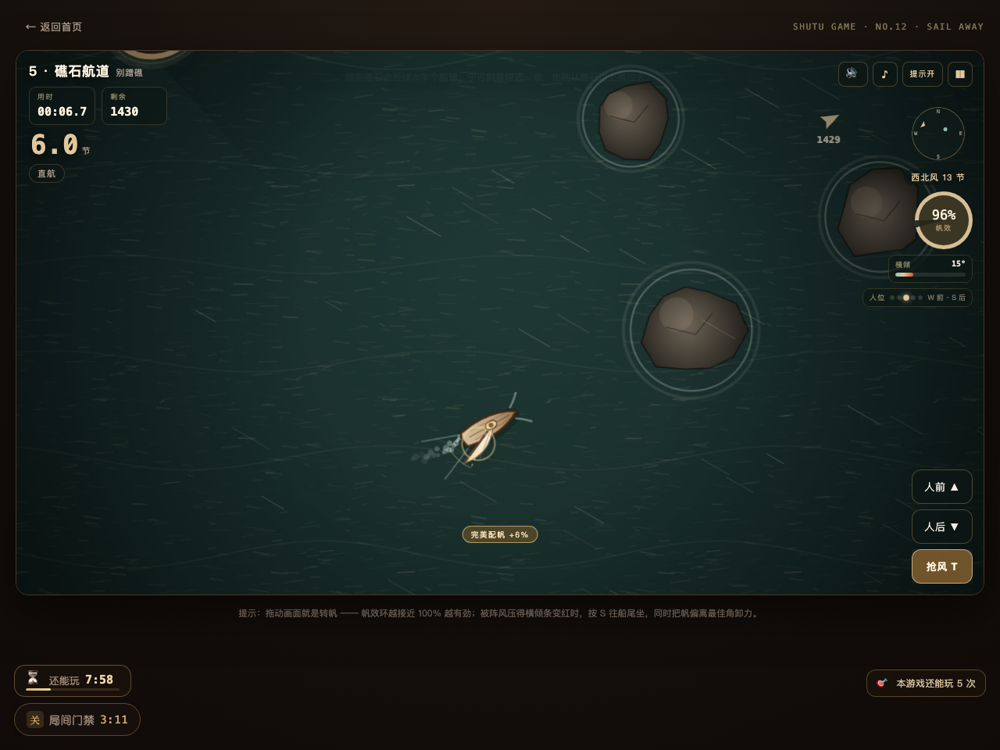

# 碧海扬帆 · SAIL AWAY

顶视海图上的帆船航行游戏。风向随时看得见，但船不会自动跑 ——
你要把**帆摆多少、人站船头还是船尾、什么时候抢风**这三件事同时调对，
船才吃得住风。



打开 `sailing/sailing.html` 即可玩，无构建、无外部依赖；
入口在仓库首页第 12 张卡片。

## 操作

| 操作 | 键鼠 | 触屏 |
| --- | --- | --- |
| 调帆角 | 在画面上拖动（帆杆跟着指针走）/ `←` `→` | 在画面拖动 |
| 人前移 / 后移 | `W` / `S` | 右下「人前 ▲」「人后 ▼」 |
| 抢风换舷 | `T` | 右下「抢风 T」 |
| 暂停 | `P` / `Esc` | 右上暂停按钮 |
| 音效 / 音乐 | `M`（音效）· 工具栏两个独立开关 | 右上 🔊 与 ♪ |
| 确认 / 继续 | `Enter` | 面板按钮 |

舵是**自动的**：默认朝目标跑，按 T 后沿「风来向 ± 48°」的斜线跑。
单击画面不会甩帆 —— 要拖动超过 10 像素才接管帆角，避免误触。

## 三个关键（这一关为什么这么玩）

1. **横风最快，顺风反而慢。** 帆在攻角 50° 上下升力最大；风从正后方来时升力转不成前进分量，
   所以顺风要把帆放到接近 85°「兜风」。右上角帆效环填到 100% 且变金，就是吃满了。
2. **顶风不动。** |视风角| < 42° 是死区，再怎么调帆也只有一两成力；
   目标在死区里就按 T 抢风，走斜线，快撞到目标再切回来。
3. **人位是配平。** 站船头：抗横倾 0.65 倍、速度 +7%、侧漂 −30%；
   站船尾：抗横倾 1.35 倍、转向快 40%。风大就往船尾坐。

模型细节：视风 = 真风 − 船速；`drive = liftK·sin(2α)/2 + dragK·sin(α)`，
横倾超过 30° 开始掉效率、46° 压不住船（2.2 秒失控后重新起航）；
连续 2 秒高效配帆给「完美配帆 +6%」速度奖励。

## 八关航程

| # | 关卡 | 机制 | 三星 / 二星 |
| --- | --- | --- | --- |
| 01 | 启航课 | 顺风直航，帆放到 85° 兜风 | 00:50 / 01:06 |
| 02 | 横风穿行 | 横风最佳，帆收到 50° 上下 | 00:26 / 00:36 |
| 03 | 迎风抢风 | 目标在死区，必须 T 抢风走斜线 | 00:36 / 00:50 |
| 04 | 风摆无常 | 风在 ±34° 摆，帆要跟着风玫瑰转 | 00:32 / 00:45 |
| 05 | 礁石航道 | 五块礁石摆成航道，蹭边掉七成速度 | 00:34 / 00:46 |
| 06 | 背风阴影 | 大岛背风侧风几乎没了，绕北边走 | 00:28 / 00:38 |
| 07 | 阵风考验 | 阵风 ×1.75，横倾要压住、帆要卸力 | 00:24 / 00:34 |
| 08 | 海峡决赛 | 阵风 + 风摆 + AI 对手（0.92 系数） | 00:24 / 00:34 |

星级规则：抵达即 1★，用时 ≤ `par2` 2★，≤ `par` 3★（`par` / `par2` 写在 `config.js`，用
`node tools/validate-levels.js` 重算校验）。八关全通后进入「海上老船长」总成绩页，总星 24 颗。

地形除了礁石还有**岛**：岛会挡住下风向，形成一片风影区（画面上有半透明风影）；
海岸线撞上去掉一半速度，礁石掉七成。

## 动效与音频

- **海面**：三层浪纹按速度视差滚动 + 七条正弦涌浪线，越靠边越慢，营造纵深；
- **风**：随风速变化的风痕线、阵风时全屏暖光压角、顶风时帆面抖动；
- **船**：帆随受力鼓起（3 条帆骨）、横倾时整体旋转、船影与随速度张开的 V 形尾流、
  船首双侧浪花、青白泡沫尾迹粒子；
- **反馈**：完美配帆金晕、撞礁震屏、屏外目标用边缘箭头 + 距离数字、暗角收边。
- **音频**（`audio.js`，全 WebAudio 合成，无音频文件）：海浪底噪 + 风声（随风速调增益与频率）、
  事件音（换舷 / 撞礁 / 抵达 / 阵风）、D 调五声循环 BGM。音效与音乐各有独立开关，
  首次点击或按键时解锁 AudioContext（浏览器策略）。

## 门禁与时长限制

与全站其他游戏一致：

- **局间门禁**：累计游玩 5 分钟弹全屏题，答对才能继续；题型为「口算填空」+「唐诗接下句」随机，
  徽标在左下角，`localStorage` 存档按页分档，刷新不能绕过；
- **限次**：`GameLimit.count("sailing")`，每**完整抵达终点**记 1 次，5 次用完后锁 15 分钟；
  中途退出、失败不计数（可无限重跑）；
- **强制休息**：`playclock` 每玩 30 分钟全站休息 10 分钟，本游戏监听 `playclock:breakstart/breakend`
  暂停主循环与计时。

## 存档

| 键 | 内容 |
| --- | --- |
| `shutu.sailing.v1` | `stars`（各关星数）、`best`（各关最佳用时）、`assist`（是否开启最佳帆角提示） |
| `shutu.sailing.mute.v1` | 音效静音状态 |
| `shutu.sailing.music.v1` | BGM 开关状态 |

`localStorage` 不可用时退化为内存存档，不影响本局游玩。解锁不做限制：八关随时可点，
只是没通过的那关不会记星。

## 调试参数

| 参数 | 作用 |
| --- | --- |
| `?level=N` | 直接进第 N 关（1–8） |
| `?autostart=1` | 跳过菜单直接开航 |
| `?debug=1` | 左下角显示航向 / 帆角 / AWA / 攻角 / 视风 / drive / eff / 船速 / 横倾 |

例：`sailing.html?level=7&autostart=1&debug=1` 直接进阵风关看读数。

控制台可用 `SAIL.checkLevels()` 做关卡静态检查（起点压岛、目标压礁、星级时间非法等）。

## 目录

```
sailing/
├── sailing.html               页面、HUD（风玫瑰 / 帆效环 / 横倾条 / 人位点）、五个 overlay
├── sailing.css                咖啡金主题、菜单三栏、HUD、结算星级、触屏按钮、响应式
├── config.js                  TUNE 全部手感参数 + 八关关卡表 + validateLevels 静态自检
├── audio.js                   WebAudio 合成：海浪 / 风 / 事件音 / 五声 BGM，双开关
├── game.js                    渲染（海面、岛、礁、船、尾迹）、物理、关卡流程、门禁限次接入、存档
└── tools/validate-levels.js   与 game.js 同构的离线模拟器：自动航行跑八关，校验星级余量
```

关键常量在 `config.js` 的 `SAIL.TUNE`：`viewW 1280` / `viewH 720` / `pxPerKnot 10` /
`sailMax 85` / `noGo 42` / `tackOffset 48` / `forceK 0.9` / `heelK 0.24` / `heelFlip 46` / `rivalRate 0.92`。
改这些必须同步跑一次 `node tools/validate-levels.js`，并按结果调 `par` / `par2`。

## 验收记录

- `node --check game.js`、`node --check config.js`、`node --check audio.js` 全部通过；
- `node sailing/tools/validate-levels.js` 退出码 0，八关自动航行余量 +23%~+44%，0 撞礁；
- 浏览器实测：渲染、拖拽调帆、键盘 ←/→ 与 W/S、抢风换舷、阵风横倾、撞礁、
  L8 对手进度、单关结算三星与按钮、局间门禁答题、限次计数均正常，无 console 报错；
- 顺风 / 横风 / 顶风三种工况的帆效与船速符合预期（顶风 0.4 节 → 抢风后 5.2 节）。
